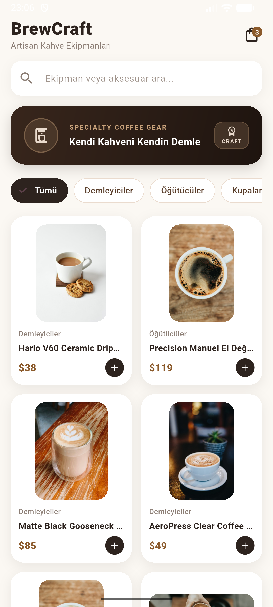
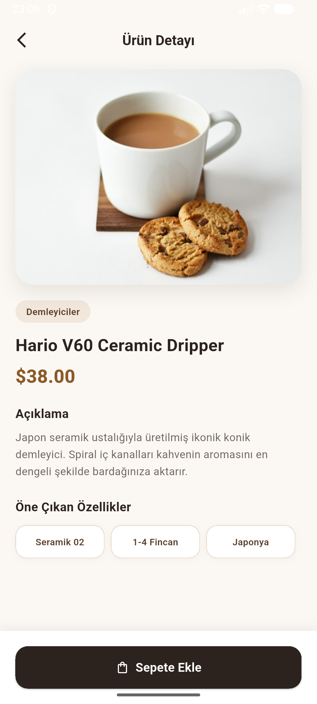
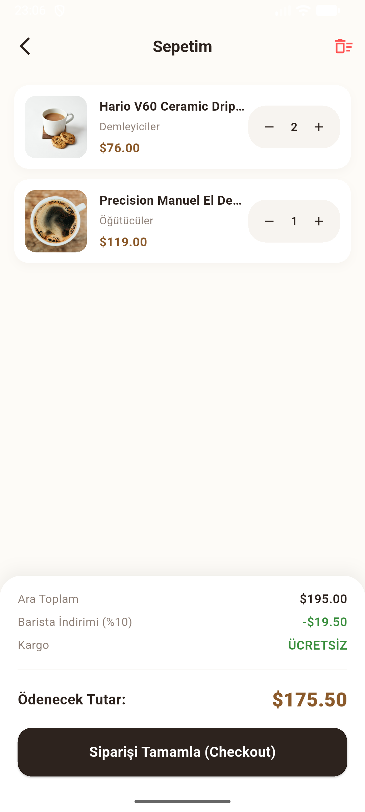

# ☕ BrewCraft - Artisan Coffee Gear & Catalog App

**BrewCraft**, nitelikli kahve demleme ekipmanları için tasarlanmış, modern ve performans odaklı bir Flutter mobil mini katalog uygulamasıdır. Standart şablonların dışına çıkılarak sıcak espresso ve fildişi tonlarında özgün bir marka kimliği oluşturulmuş; temiz mimari, modüler klasör yapısı ve saf Flutter State Management prensipleriyle geliştirilmiştir.

---

## 📱 Ekran Görüntüleri (Screenshots)

| Keşfet & Filtreleme | Ürün Detay & Specs | Sepet & Sipariş Özeti |
| :---: | :---: | :---: |
|  |  |  |

---

## ✨ Öne Çıkan Özellikler

### 1. Dinamik Filtreleme ve Arama Mekanizması
- **Kategori Çipleri (ChoiceChips):** `Demleyiciler`, `Öğütücüler`, `Kupalar`, `Tartı & Aksesuar` sekmeleriyle anlık kategori filtreleme.
- **Akıllı Arama Normalizasyonu:** Kullanıcı aramalarında hem ürün adına hem kategoriye hem de açıklamalara bakar. Türkçe karakter (`ö, ü, ç, ş, ğ, ı`) ve İngilizce klavye uyumsuzluklarını otomatik normalize eder.

### 2. Kullanıcı Deneyimi (UX) İyileştirmeleri
- **Otomatik Klavye Kapatma (Unfocus):** Ekrandaki herhangi bir boşluğa dokunulduğunda veya sayfa kaydırıldığında klavye odağını kapatır.
- **Vektörel Marka Kimliği:** Dahili Flutter vektörleriyle oluşturulmuş özel amblemli artisan banner alanı.

### 3. Ürün Detayı (Navigator Routing)
- Tıklanan ürünü `Navigator.push` ile detay sayfasına taşıma.
- Yüksek çözünürlüklü ürün görseli, kategori etiketi, kullanıcı puanı (rating), teknik özellik rozetleri (`specs`) ve sepete ekleme aksiyonu.

### 4. Gelişmiş Sepet & Sipariş Simülasyonu
- **Adet Yönetimi:** Aynı ürün eklendiğinde liste uzamaz, miktarı artar. Sepet ekranında `+` ve `-` butonlarıyla anlık adet güncelleme ve sıfıra inince listeden kaldırma.
- **Dinamik Fiyatlandırma & İndirim:**
  - **Ara Toplam (Subtotal):** Sepetteki ürünlerin anlık toplamı.
  - **Barista İndirimi (%10):** Sepet tutarına göre anlık hesaplanan indirim düşüşü.
  - **Akıllı Kargo:** 100$ ve üzeri siparişlerde otomatik **ÜCRETSİZ**, altındaki siparişlerde standart 5$ kargo ücreti.
  - **Net Toplam:** İndirim ve kargo dahil son ödenecek tutar dökümü.
- **Boş Sepet Durumu (Empty State):** Sepette ürün kalmadığında kullanıcıyı karşılayan estetik boş sepet alanı.

---

## 🏗️ Proje Mimarisi ve Klasör Yapısı

```text
lib/
├── data/
│   └── mock_products.dart         # Kahve ekipmanları mock veri listesi
├── models/
│   └── product.dart               # Product veri sınıfı (id, title, category, price, specs vb.)
├── screens/
│   ├── catalog_screen.dart        # Keşfet, arama, banner, filtreleme ve GridView ekranı
│   ├── product_detail_screen.dart # Ürün detay sayfası ve teknik özellikler
│   └── cart_screen.dart           # Miktar yönetimi ve dinamik sipariş özeti ekranı
└── main.dart                      # Uygulama başlangıç noktası ve tema konfigürasyonu

```

---

## 🛠️ Teknik Altyapı

**Flutter Sürümü:** Flutter 3.x (SDK >= 3.22.0 / Material 3)
**Dart Sürümü:** Dart 3.x (SDK >= 3.4.0)
* **Durum Yönetimi (State Management):** Pure Flutter `StatefulWidget` & `setState` (Harici paket bağımlılığı olmadan temiz veri akışı)
* **Tasarım:** Custom Barista Palette (Espresso `#2D231E`, Fildişi `#FDFBF7`, Karamel `#8B5A2B`)
* **Sürüm Kontrolü:** Git & GitHub

---

## 🚀 Kurulum ve Çalıştırma

1. **Repoyu klonlayın:**
```bash
git clone [https://github.com/Sn-Sevda/mini_catalog_app.git](https://github.com/Sn-Sevda/mini_catalog_app.git)
cd mini_catalog_app

```


2. **Bağımlılıkları kontrol edin:**
```bash
flutter pub get

```


3. **Uygulamayı emülatörde veya fiziksel cihazda başlatın:**
```bash
flutter run

```


---

## 👤 Geliştirici

* **GitHub:** [@Sn-Sevda](https://www.google.com/search?q=https://github.com/Sn-Sevda)


